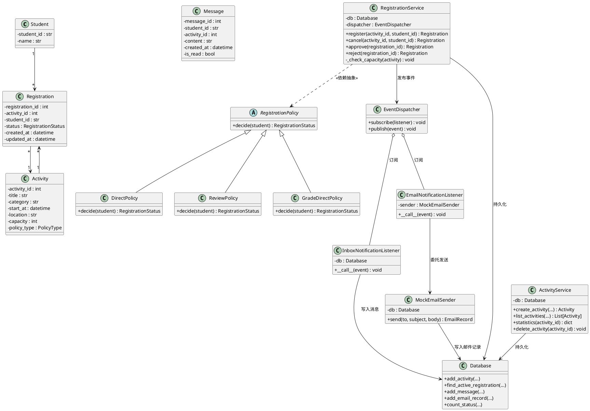
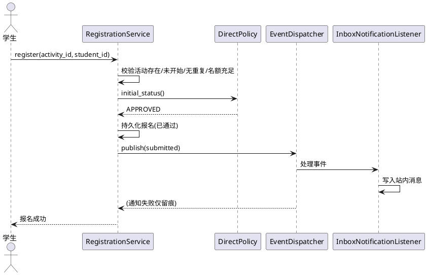
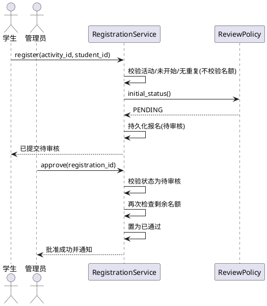

# 实验二设计文档：基于设计模式的校园活动报名与管理系统

项目代号：CampusEvent

## 1. 初始 SRS 分析

### 1.1 领域数据与角色

| 角色 | 说明 |
|------|------|
| Student（学生） | 浏览活动、报名、取消报名、查看站内消息 |
| Admin（管理员） | 创建/编辑/删除活动、批准/拒绝报名、查看统计 |

### 1.2 领域对象

| 对象 | 主要字段 | 约束 |
|------|----------|------|
| Student | student_id、name | 学生 ID 唯一 |
| Activity | activity_id、title、category、start_at、location、capacity、policy_type | 容量为正整数；活动开始前允许报名 |
| Registration | registration_id、activity_id、student_id、status、created_at、updated_at | 状态限待审核/已通过/已拒绝/已取消 |
| Message | message_id、student_id、activity_id、content、created_at、is_read | 报名或审核动作产生站内消息 |

### 1.3 初始业务规则（B.2）

1. 直接报名：名额充足且符合基本条件时，创建"已通过"报名，同时产生站内通知。
2. 审核型活动：提交后为"待审核"，由管理员批准或拒绝；批准时再次检查剩余名额。
3. 名额统计按"已通过"报名计算；待审核不占名额；满员后不得再批准新报名。
4. 同一学生对同一活动不得存在两条"待审核/已通过"的有效报名；已取消/已拒绝保留历史，允许再次申请。
5. 学生可取消自己的"待审核/已通过"报名；活动开始后不允许新增报名。
6. 通知失败应留痕，但不得导致合法报名记录消失。
7. 活动与报名记录须持久化；管理员删除已有报名的活动，采用"软删除"。

### 1.4 核心功能清单

| 编号 | 功能 | 说明 |
|------|------|------|
| P2-F01 | 活动管理 | 管理员创建、编辑、删除活动 |
| P2-F02 | 活动查看 | 学生浏览列表与详情，按名称筛选 |
| P2-F03 | 报名/取消 | 报名、取消；禁止重复有效报名 |
| P2-F04 | 报名策略 | 直接报名自动通过；审核型进入待审核 |
| P2-F05 | 审批操作 | 批准/拒绝，批准时再次检查名额 |
| P2-F06 | 状态管理 | 待审核/已通过/已拒绝/已取消 |
| P2-F07 | 站内通知 | 报名及审核结果写入站内消息 |
| P2-F08 | 统计 | 已通过数、待审核数、剩余名额 |

---

## 2. 用例说明

### 用例 UC-1：学生报名活动

- **主参与者**：学生
- **前置条件**：活动存在、尚未开始、学生未重复有效报名
- **主流程**：
  1. 学生选择活动并提交报名；
  2. 系统判断活动报名方式；
  3. 直接报名 → 名额充足则状态置为"已通过"，产生站内通知；
  4. 审核报名 → 状态置为"待审核"，等待管理员处理；
- **扩展流**：名额已满（直接报名）→ 拒绝并提示；活动已开始 → 拒绝。

### 用例 UC-2：管理员审批报名

- **主参与者**：管理员
- **前置条件**：存在"待审核"报名
- **主流程**：
  1. 管理员查看待审核报名；
  2. 批准 → 再次检查剩余名额，通过则置为"已通过"并通知；
  3. 拒绝 → 置为"已拒绝"并通知；
- **扩展流**：批准时名额已满 → 批准失败，不超出上限。

---

## 3. UML 类图

采用 PlantUML 描述，最终类图以图形式交付（docs/uml/ 目录）。

### 类图说明

- **依赖方向**：`RegistrationService` 依赖 `RegistrationPolicy` 抽象，而非具体策略；
- **职责划分**：`ActivityService` 管活动，`RegistrationService` 管报名事务，`EventDispatcher` + 监听器管通知；
- **解耦**：报名业务不直接写消息，而是发布事件，由监听器消费。

---

## 4. 时序图

### 4.1 直接报名时序

### 4.2 审核报名与批准时序

---

## 5. 设计模式决策报告

### 5.1 为什么使用策略模式（RegistrationPolicy）

**问题**：报名规则存在两种变化——"直接报名"与"管理员审核"，未来可能新增"抽签报名""积分报名"等。若在 `register` 主流程中用 `if policy_type == "direct"` 硬编码判断，每加一种规则都要改主流程，违反开闭原则（OCP）。

**方案**：抽象 `RegistrationPolicy` 接口，`DirectPolicy`/`ReviewPolicy` 分别实现。`RegistrationService` 只依赖抽象，通过 `policy_for()` 工厂按活动类型选择策略。

**名额检查归属**：名额检查是"公共规则"，放在 `RegistrationService._check_capacity()` 统一执行，而非放进具体策略。原因：
- 两种策略都必须遵守"已通过人数 ≤ 容量"这一全局不变量，属于横切规则；
- 审核型活动的批准路径需要"再次检查名额"，若名额检查散落在策略内部，批准逻辑无法复用同一校验，易产生不一致；
- 策略只负责"决定提交后的初始状态"，职责单一（SRP）。

### 5.2 为什么使用观察者模式（EventDispatcher）

**问题**：报名业务与站内通知耦合。若在 `register` 内直接写 `db.add_message()`，则：
- 新增通知渠道（邮件、短信）需改动业务主流程；
- 通知失败可能影响报名事务，反之亦然。

**方案**：业务层发布 `RegistrationEvent`，`InboxNotificationListener` 订阅并写站内消息。通知失败只留日志，不影响报名落库。

**事务边界**：报名与通知分属两个独立步骤。报名提交先落库成功，再派发通知；通知失败不导致报名回滚（留痕即可），符合规则6"通知失败应留痕，但不得导致合法报名记录消失"。

**避免重复通知**：每个业务动作只发布一次对应事件（submitted/approved/rejected/cancelled），监听器按事件幂等消费，不重复写入。

### 5.3 采用模式带来的成本

- 新增了抽象层（策略接口、事件分发器），类数量增加，初学者阅读门槛略高；
- 需额外维护工厂函数与事件类型约定；
- 若业务规则长期只有两种且不变化，直接 `if-else` 反而更简单——本实验正是以"需求变更"为假设前提，模式收益得以体现。

### 5.4 未来扩展方向

- 新增报名方式（如抽签）：实现新的 `RegistrationPolicy` 子类即可，主流程零改动；
- 新增通知渠道（如邮件）：新增一个监听器订阅事件，无需改报名服务；
- 新增审批规则（如名额预占）：调整 `_check_capacity` 或引入新策略即可。

---

## 6. 学生设计检查表（B.3）对照

| 检查项 | 是否满足 | 说明 |
|--------|----------|------|
| UML 类图体现活动/学生/报名/业务/通知职责 | ✅ | 见第 3 节 |
| 至少一个报名策略接口及两种实现 | ✅ | RegistrationPolicy + Direct/Review |
| 说明策略选择与公共规则检查位置 | ✅ | 见 5.1 |
| 通知通过观察者模式解耦 | ✅ | EventDispatcher + 监听器 |
| 至少两张时序图 | ✅ | 直接/审核报名、批准 |
| 明确名额超限、重复报名、取消、审批冲突边界 | ✅ | 见测试用例 |
| 提供设计取舍说明 | ✅ | 见 5.3 |
